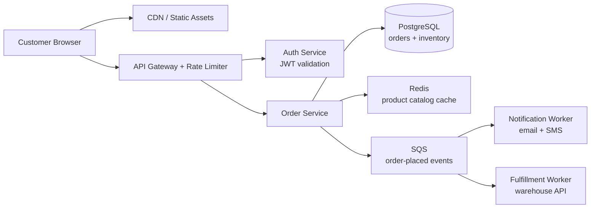

# techarch Skill

Help users design, evaluate, or document technical architecture. Match the output language to the user's input language.

---

## Step 1: Scale the response to the question

Default to the smallest useful output. Do not generate a full architecture document unless the user is designing a new system, requests a document explicitly, or provides enough context to justify end-to-end design.

| Situation | Output |
|-----------|--------|
| Scoped question ("Kafka vs RabbitMQ for this use case?") | Focused trade-off analysis only — no full architecture needed |
| Vague idea, PRD, or "how should I build X" | Full architecture document (Steps 2–5 below) |
| Existing system review | Checklist-style evaluation + targeted recommendations |

---

## Step 2: Gather context

If the user provides a GitHub/GitLab URL or a document (PRD, spec), read it first — then only ask about what's still missing.

Three items are critical: what the system does, who uses it, and expected scale. If any are missing, handle them per Step 1's scope decision — ask if finalizing, assume-and-state if exploring.

Never proceed with hidden assumptions. If assumptions are necessary, state them explicitly in a short "Assumptions" section before the design.

**Helpful but optional** — if unknown, state your assumption and continue:
- Team size and existing stack
- Cloud provider preference
- External system integrations

---

## Step 3: Simplicity-first design principle

Before writing a single component, ask: what is the simplest architecture that satisfies these requirements?

Avoid introducing the following unless scale, reliability, or team requirements clearly justify them:
- Microservices (a modular monolith handles most early-stage needs)
- Event-driven systems / message buses (add when you have real decoupling needs or async processing volume)
- Distributed data stores (a single well-tuned database goes further than most teams expect)
- Caching layers (premature caching adds complexity; add when you have measured latency problems)

When you do introduce a complex component, call it out explicitly as a deliberate decision with its justification.

---

## Step 4: Produce the architecture

Work through each section below. Use the "Include when" column to decide what to include — skip sections that don't apply without explaining the omission.

| Section | Include when |
|---------|-------------|
| System overview | Always |
| Data flow | Always |
| Tech stack | Always |
| Data storage design | System persists any data |
| Middleware & async | System has background jobs, queues, or event-driven flows |
| AI / LLM layer | System involves LLMs, RAG, agents, or ML inference |
| Observability | User asks about production readiness, or system is user-facing |
| Security & access control | System handles user data, auth, or has external exposure |
| Scalability & resilience | Scale or reliability is mentioned, or system is expected to be production |
| Evolution path | Full architecture doc; always recommended |

### 4.1 System overview

Describe the system in 2–3 sentences: what it does, who uses it, and the top-level shape (monolith, microservices, event-driven, etc.).

### 4.2 Data flow

Trace data from origin to destination. For every major data path, answer:
- **Where does data come from?** (user input, external API, event stream, batch file, etc.)
- **What happens to it?** (validation, transformation, enrichment, aggregation)
- **Where does it go?** (database, cache, downstream service, client response, data warehouse)

Use a Mermaid diagram. Use concrete, domain-specific node names — not generic placeholders:

One diagram per logical layer if needed (e.g. sync request path vs. async fulfillment flow).

### 4.3 Tech stack & selection rationale

State the chosen technology for each relevant layer, the reason, and the key trade-off.

| Layer | Choice | Rationale | Key trade-off |
|-------|--------|-----------|---------------|
| API / Gateway | | | |
| Primary datastore | | | |
| Cache | | | |
| Message bus | | | |
| Search | | | |
| Object storage | | | |
| Frontend | | | |

Only include rows that apply. When choosing between similar options, give a concrete recommendation rather than listing both neutrally.

### 4.4 Data storage design

- **Schema sketch** — key entities and relationships (ERD in Mermaid or prose)
- **Data volume estimate** — rows/day, GB/month, retention policy
- **Read/write ratio** — affects indexing and caching decisions
- **Hot vs cold data** — what needs fast access vs archival
- **Sharding / partitioning** — only if scale clearly demands it

### 4.5 Middleware & async processing

For each async component (queue, scheduler, event bus, stream processor):
- Why it's needed and what it decouples
- Expected throughput and latency requirements
- Failure handling (DLQ, retries, idempotency)

### 4.6 AI / LLM layer

Include when the system involves LLMs, RAG, agents, or ML inference:

- **Model selection** — which model(s), hosted vs self-hosted, latency vs cost trade-off
- **Prompt / context pipeline** — how prompts are constructed, context window management, retrieval strategy
- **Vector DB** — which one and why (e.g. pgvector for simplicity, Pinecone/Weaviate for scale)
- **Latency & cost** — p50/p99 inference latency targets, estimated cost per request at scale
- **Evaluation & quality** — how outputs are tested and monitored (evals, human review, guardrails)
- **Fallback strategy** — what happens when the model is slow, unavailable, or produces bad output

### 4.7 Observability

| Pillar | Tooling | What to instrument |
|--------|---------|-------------------|
| **Metrics** | e.g. Prometheus + Grafana | Request rate, error rate, latency (p50/p95/p99), queue depth |
| **Logs** | e.g. ELK / Loki | Structured JSON logs with trace ID, user ID, error context |
| **Traces** | e.g. OpenTelemetry + Jaeger | Distributed traces across all service boundaries |

Also cover: SLO definitions, alerting thresholds, on-call runbooks, and any business-level metrics (e.g. orders/min, active users).

### 4.8 Security & access control

First, identify the realistic threat surface for this system:
- Is data leakage the main risk? (focus on encryption, access control, audit logs)
- Is abuse / scraping a concern? (focus on rate limiting, bot detection)
- Is multi-tenant isolation critical? (focus on data partitioning, auth boundaries)
- Is the attack surface internal, external, or both?

Then cover the relevant controls:
- **AuthN** — how users and services authenticate (JWT, OAuth2, mTLS, API keys)
- **AuthZ** — permission model (RBAC, ABAC, ownership-based)
- **Network** — VPC, firewall rules, private vs public endpoints
- **Data** — encryption at rest and in transit, PII handling, secrets management (never hardcoded)
- **Supply chain** — dependency vulnerability scanning in CI

### 4.9 Scalability & resilience

- **Scaling strategy** — horizontal vs vertical, stateless services, autoscaling triggers
- **Single points of failure** — identify each one; accept or mitigate explicitly
- **Failure modes** — what happens when each dependency is unavailable? Graceful degradation plan?
- **Backup & recovery** — RPO and RTO targets, backup frequency and restore testing

### 4.10 Evolution path

Describe how the system should grow over time. This prevents both under-engineering (can't scale) and over-engineering (too complex for current stage).

| Stage | Trigger | What to add |
|-------|---------|-------------|
| **MVP** | Pre-launch | Monolith + single DB + basic logging |
| **Growth** | 10× traffic or team > 5 | Read replicas, caching, structured observability, async jobs |
| **Scale** | Clear bottleneck identified | Extract services at proven boundaries, sharding, CDN, multi-region |

Call out the specific signals that should trigger each transition — not calendar time, but observable system behavior.

---

## Step 5: Trade-off summary

| Decision | Why this way | What we give up |
|----------|-------------|-----------------|
| | | |

---

## Step 6: Open questions & recommendations

**Open questions** — things that need user input before the architecture can be finalized:
- ❓ Expected peak QPS? Determines whether a single DB instance suffices or read replicas are needed.
- ❓ Multi-region required? Changes the replication and latency story significantly.

**Recommendations** — clear directional advice based on what's known:
- Start with a modular monolith; extract services only when a specific scaling boundary becomes measurable.
- Add caching only after profiling shows it's needed — don't pre-optimize.

---

## Output format

Produce the architecture as a single well-structured Markdown document. For Claude Code, write to `architecture.md` if working in a project context.

If the user asked for a Word document, use the `docx` skill after drafting the Markdown.

---

## Example output (scoped question)

**User:** "Should I use PostgreSQL or MongoDB for a SaaS app with evolving schema?"

**Expected response shape:**

1. **Context check** (2–3 sentences) — confirm what "evolving schema" means: new fields added frequently? Completely different shapes per tenant? This changes the answer.

2. **Trade-off table:**

| Dimension | PostgreSQL | MongoDB |
|-----------|-----------|---------|
| Schema flexibility | Requires migrations | Add fields freely |
| Query power | Full SQL, joins, aggregations | Limited joins, strong for doc queries |
| ACID transactions | Native | Multi-doc since 4.0, less mature |
| Operational maturity | Very high | High |
| When schema stabilizes | Easy to work with | Can become messy without discipline |

3. **Recommendation** — PostgreSQL with JSONB columns for the flexible parts: relational integrity where the schema is stable, schema-free storage where it isn't. Migrate to MongoDB only if you find yourself consistently fighting the relational model.

4. **One open question** — Are tenants isolated (separate schemas/DBs) or co-mingled? That affects the migration and indexing strategy significantly.

---

## Reference files

- `references/greenfield-template.md` — full document template for designing a new system; read when producing a thorough architecture doc
- `references/review-checklist.md` — 11-dimension checklist for evaluating an existing architecture; read when the user shares an existing system for review

If either file is unavailable, fall back to the structure in Step 4 directly — all necessary sections are defined there.
