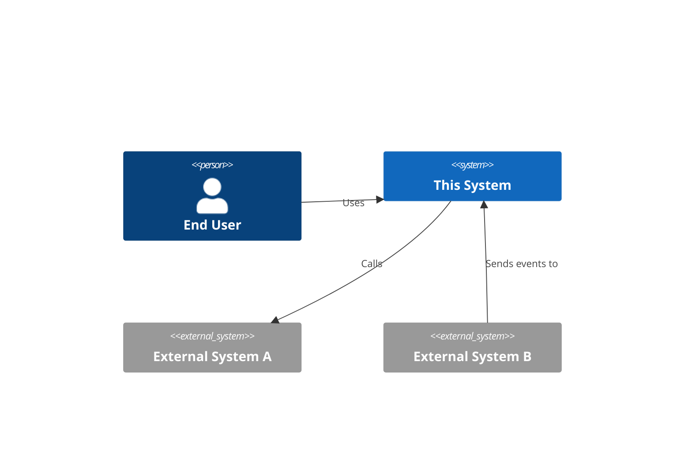
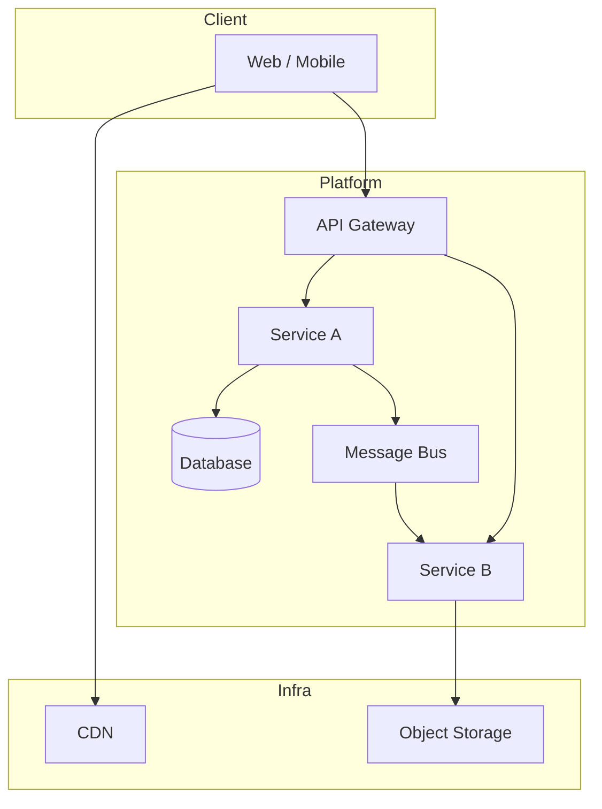
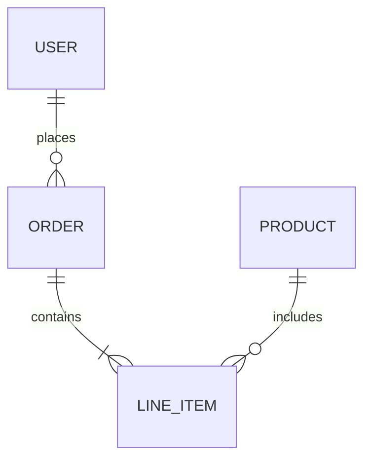

# Greenfield Architecture Template

Use this template when designing a new system from scratch. Fill in each section — leave a `TBD` placeholder with an explanation if information isn't available yet.

---

# Architecture: [System Name]

**Version**: 1.0  
**Author**: [Author]  
**Date**: [Date]  
**Status**: Draft / In Review / Approved

---

## 1. Executive Summary

> One paragraph: what the system does, who uses it, and the key architectural decisions made.

---

## 2. Requirements Summary

### Functional
- [ ] Core capability 1
- [ ] Core capability 2

### Non-Functional
| Attribute | Target |
|-----------|--------|
| Availability | e.g. 99.9% |
| Latency (p99) | e.g. < 500ms |
| Throughput | e.g. 1,000 req/s peak |
| Data retention | e.g. 90 days hot, 7 years cold |
| RTO / RPO | e.g. RTO 1hr / RPO 15min |

---

## 3. System Context



---

## 4. High-Level Architecture



---

## 5. Component Breakdown

For each major component:

### [Component Name]
- **Responsibility**: What it owns
- **Technology**: Chosen tech + version
- **Interfaces**: APIs it exposes / consumes
- **Data it owns**: Entities, schemas
- **Scaling unit**: How it scales independently

---

## 6. Data Architecture

### Entity Overview


### Storage Mapping
| Entity / Dataset | Store | Reason | Estimated size |
|-----------------|-------|--------|----------------|
| User profiles | PostgreSQL | Relational, ACID | ~10M rows |
| Events / audit log | ClickHouse | Append-only, analytics | ~1B rows/year |
| Blob assets | S3 | Unstructured, cheap | ~10TB |
| Session cache | Redis | Low-latency lookup | ~50GB |

---

## 7. API Design

### External APIs (consumed by clients)
- Protocol: REST / GraphQL / gRPC
- Auth: JWT Bearer / OAuth2 / API Key
- Versioning strategy: URL path (`/v1/`) / header

### Internal APIs (service-to-service)
- Protocol: gRPC / REST / async events
- Auth: mTLS / service tokens

Key endpoints (sketch):
```
POST /v1/resources       Create
GET  /v1/resources/:id   Read
PUT  /v1/resources/:id   Update
DELETE /v1/resources/:id Delete
GET  /v1/resources       List (paginated)
```

---

## 8. Async / Event Architecture

| Event | Producer | Consumer(s) | Broker | SLA |
|-------|----------|-------------|--------|-----|
| user.created | Auth Service | Email Service, Analytics | Kafka | At-least-once |
| order.placed | Order Service | Inventory, Billing | Kafka | Exactly-once |

---

## 9. Infrastructure & Deployment

- **Cloud provider**: AWS / GCP / Azure / On-prem
- **Regions**: Primary + DR region
- **Container strategy**: Kubernetes / ECS / Serverless
- **CI/CD**: GitHub Actions / GitLab CI → ArgoCD / Spinnaker
- **IaC**: Terraform / Pulumi / CDK

```
Environments: dev → staging → production
Deployment: Blue/green | Canary | Rolling
```

---

## 10. Observability Plan

### Metrics (Prometheus + Grafana)
- RED metrics per service: Request rate, Error rate, Duration
- USE metrics per host: Utilization, Saturation, Errors
- Business KPIs: e.g. orders/min, active users

### Logging (structured JSON)
Required fields on every log line: `timestamp`, `level`, `service`, `trace_id`, `user_id` (if applicable), `message`

### Tracing (OpenTelemetry → Jaeger / Tempo)
- Instrument all service entry points
- Propagate `trace_id` across async boundaries

### Alerting
| Alert | Threshold | Severity | Runbook |
|-------|-----------|----------|---------|
| Error rate | > 1% over 5min | P1 | link |
| p99 latency | > 2s over 5min | P2 | link |
| Queue lag | > 10k msgs | P2 | link |

---

## 11. Security

| Concern | Approach |
|---------|----------|
| User AuthN | OAuth2 + OIDC (e.g. Auth0 / Cognito) |
| Service AuthN | mTLS + service accounts |
| AuthZ | RBAC — roles defined in auth service |
| Secrets | Vault / AWS Secrets Manager — never in env vars |
| Encryption at rest | AES-256, cloud-managed keys |
| Encryption in transit | TLS 1.2+ everywhere |
| PII handling | Tokenization / masking in logs and analytics |
| Vulnerability scanning | Snyk / Dependabot in CI |

---

## 12. Trade-offs & Alternatives Considered

| Decision | Chosen | Alternative | Why not alternative |
|----------|--------|-------------|---------------------|
| | | | |

---

## 13. Open Questions

| # | Question | Owner | Due |
|---|----------|-------|-----|
| 1 | | | |

---

## 14. Appendix

- Links to related docs
- Glossary of domain terms
- Reference architectures consulted
